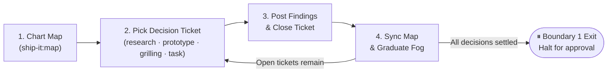
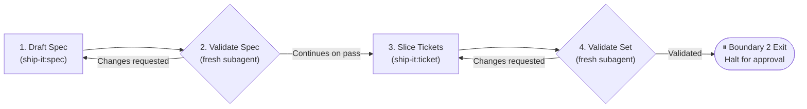
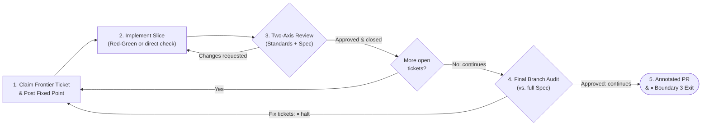

# ship-it

[](https://awhipp.github.io/ship-it/)
[](https://agentskills.io)

**Disciplined feature delivery for engineering teams.** Drive features from idea to pull request using explicit phase gates, independent reviews, isolated subagents, and GitHub issues as the single source of truth.

```txt
Boundary 1: Mapping       Boundary 2: Definition       Boundary 3: Execution
    [ Plan ]        ──▶    [ Spec ──▶ Tickets ]   ──▶   [ Implement ──▶ Review ──▶ Final Review ]
 ⏸ Human Gate               ⏸ Human Gate                ⏸ Human Gate (Annotated PR)
```

---

## Quickstart

### 1. Prerequisites

Install and authenticate `git` and the GitHub CLI (`gh` 2.94.0 or later):

```bash
gh auth status
```

### 2. Install

```bash
npx skills install awhipp/ship-it
```

Or copy `skills/ship-it` into `.agents/skills/ship-it` or your harness's global skills folder.

### 3. Run with a directive

Every invocation requires an explicit directive so the conductor never guesses what to work on:

```txt
/ship-it "add search caching"   # Start a new feature from an idea
/ship-it #42                    # Start from an existing issue, or resume a ship-it artifact
/ship-it search-cache           # Resume an existing feature by slug
/ship-it preflight              # Verify repo setup and provision labels
```

A bare `/ship-it` halts immediately and asks for one of these four directives before running any GitHub queries.

---

## How it works

`ship-it` guides feature development through five phases across three execution boundaries.
The conductor dispatches discrete tasks to isolated subagents or fresh sessions.
Work runs continuously within a boundary and halts at each boundary exit for human review.
Run `ship-it <slug>` to approve the current boundary deliverable and begin the next boundary.

| Boundary | Phase | What happens | Phase exit / Boundary halt | Reference |
| :--- | :--- | :--- | :--- | :--- |
| **1. Mapping** | **Plan** | Charts open decisions as a map and resolves research, prototype, grilling, and task tickets. | **Halt (Boundary 1 exit)**: Map closes with all decisions settled. | [`plan.md`](skills/ship-it/references/plan.md) |
| **2. Definition** | **Spec** | Synthesizes settled decisions into a formal specification with test seams, then validates the draft. | **Continues to Tickets** once spec carries `ship-it:validated`. | [`spec.md`](skills/ship-it/references/spec.md), [`validate.md`](skills/ship-it/references/validate.md) |
| **2. Definition** | **Tickets** | Slices the specification into ordered tracer-bullet tickets, then validates ticket dependencies. | **Halt (Boundary 2 exit)**: Every ticket carries `ship-it:validated`. | [`tickets.md`](skills/ship-it/references/tickets.md), [`validate.md`](skills/ship-it/references/validate.md) |
| **3. Execution** | **Implement & Review** | Implements each unblocked ticket on `<type>/<slug>`, reviews diffs across Standards and Spec axes, and closes approved tickets. | **Continues to Final Review** once all tickets close. | [`implement.md`](skills/ship-it/references/implement.md), [`review.md`](skills/ship-it/references/review.md) |
| **3. Execution** | **Final Review & PR** | Audits the complete branch diff against the specification, opens the pull request, and adds rationale comments to each changed file. | **Halt (Boundary 3 exit)**: PR opens and awaits human merge. | [`review.md`](skills/ship-it/references/review.md#final-review), [`implement.md`](skills/ship-it/references/implement.md#close-out) |

### Map vs. Spec

| Dimension | Decision Map (`ship-it:map`) | Feature Specification (`ship-it:spec`) |
| :--- | :--- | :--- |
| **Primary Goal** | Resolve architectural uncertainty and choose a direction. | Deliver settled requirements through verified code. |
| **When to Use** | Use when architectural fog, technical forks, or unknown APIs exist. | Use when destination, technical design, and scope boundaries are clear. |
| **Work Units** | Decision tickets: `research`, `prototype`, `grilling`, `task`. | Tracer-bullet tickets: vertical slices of end-to-end functionality. |
| **Core Output** | Recorded technical decisions and cleared fog. | Production pull request with tests, documentation, and review audit. |
| **Exit Gate** | Boundary 1 Gate: All open decisions are settled. | Boundary 3 Gate: All tickets pass two-axis review and final audit. |

- **When a Map Occurs (Boundary 1: Mapping)**: Chart a decision map when entering a feature with open technical questions or architectural fog.
  - **Explore Alternatives**: Compare multiple design approaches before committing to an implementation plan.
  - **Clear Technical Fog**: Clarify unknown APIs, external dependencies, or ambiguous system constraints.
  - **Run Decision Tickets**: Loop through open decision tickets across four types:
    - **Research (`ship-it:research`)**: Inspect documentation, existing source code, and external APIs via the `decide` subagent.
    - **Prototype (`ship-it:prototype`)**: Build disposable proof-of-concept artifacts to evaluate behavior via the `decide` subagent.
    - **Grilling (`ship-it:grilling`)**: Answer structured questions one at a time interactively with the conductor to establish technical intent.
    - **Task (`ship-it:task`)**: Complete prerequisite setup steps such as credentials or environment provisioning.
  - **Exit Halt**: While open decision tickets or unphrased fog remain, the conductor continues routing inside Boundary 1. When all decisions resolve, the conductor closes the map and halts at the Boundary 1 exit.

<details>
<summary><b>View Boundary 1: Map Lifecycle Diagram</b></summary>



</details>

- **When a Spec Occurs (Boundary 2: Definition & Boundary 3: Execution)**: Draft a specification when the feature destination and technical architecture are fully settled.
  - **Define and Validate the Specification**: Specify user stories, implementation decisions, explicit test seams, and non-goals, then audit the specification via a fresh `validate` subagent. On validation pass, execution continues automatically to ticket slicing within Boundary 2.
  - **Slice and Validate Tracer Bullets**: Decompose the validated specification into ordered GitHub issues via the `slice` subagent and audit the full ticket set via a fresh `validate` subagent. On validation pass, the conductor halts at the Boundary 2 exit.
  - **Execute Verified Vertical Slices**: Implement each unblocked ticket on `<type>/<slug>` from a recorded `Fixed point: <sha>` (`implement` subagent), verify with Red-Green tests or direct checks, and audit each diff via independent two-axis review (`review` subagent). Once all tickets close, execution continues automatically to the final review within Boundary 3.
  - **Audit and Ship**: Audit the complete branch diff against the specification (`final-review` subagent, halting for approval if fix tickets are created). On approval, open an annotated pull request (`close-out` subagent) and halt at the Boundary 3 exit for manual merge.

<details>
<summary><b>View Boundary 2: Spec & Ticket Definition Diagram</b></summary>



</details>

<details>
<summary><b>View Boundary 3: Ticket Loop & PR Close-Out Diagram</b></summary>



</details>

---

## Core guarantees

- **Deterministic Routing**: One first-match routing table in [`SKILL.md`](skills/ship-it/SKILL.md) derives the next step from GitHub issues, labels, and assignees. Identical repository state produces the same conductor action every time.
- **Explicit Directives Only**: Invoking `ship-it` without a slug, issue number, idea, or `preflight` halts immediately instead of scanning or guessing.
- **Zero-Assumption Verification**: Evaluators classify findings as **Blocker**, **Question**, or **Nit**. When an unwritten fact prevents verification, the evaluator posts a clarifying question and withholds approval until the user answers on the issue.
- **Two-Tier Context Isolation**: In Tier 1 harnesses, the conductor dispatches decision tickets, slicing, implementation, rework, validation, review, and close-out to isolated subagents via one standard packet ([`isolation.md`](skills/ship-it/references/isolation.md)). In Tier 2 harnesses, the conductor halts before validation or review and prints `ship-it <slug>` for a fresh session.
- **Two-Axis Review and Final Audit**: Reviewers audit each ticket diff across Standards and Spec axes from a recorded `Fixed point: <sha>`. After all tickets close, the final review audits the full branch diff against the specification. That review creates fix tickets for any gaps.
- **Annotated Pull Requests**: The `close-out` subagent comments on every changed file in the pull request. Each comment states what changed, why, and which ticket and specification section the change traces to. Developers merge the pull request manually.
- **Pragmatic, Domain-Aligned Verification**: Implementation applies pragmatic, domain-aligned verification using existing repository test runners and Red-Green cycles where tests apply. The workflow enforces the ad-hoc test harness prohibition for documentation and configuration. The standard also forbids naming test files after ticket numbers.
- **GitHub-Native State**: The workflow stores all state in GitHub issues, labels, comments, branches, and commits.

---

## Dogfooded: built by ship-it

- **Marketing Experience & Site Foundation**: [Spec #16](https://github.com/awhipp/ship-it/issues/16) → PR [#22](https://github.com/awhipp/ship-it/pull/22).
- **Pragmatic Testing Guidelines**: [Spec #21](https://github.com/awhipp/ship-it/issues/21) → PR [#26](https://github.com/awhipp/ship-it/pull/26).
- **Skill File DRY/SSOT Audit**: [Spec #27](https://github.com/awhipp/ship-it/issues/27) → PR [#32](https://github.com/awhipp/ship-it/pull/32).
- **Lean Implement Discovery**: [Spec #34](https://github.com/awhipp/ship-it/issues/34) → PR [#35](https://github.com/awhipp/ship-it/pull/35).
- **Fast-Path Resolution**: [Spec #36](https://github.com/awhipp/ship-it/issues/36) → PR [#37](https://github.com/awhipp/ship-it/pull/37).
- **Agnostic Harness Support**: PR [#8](https://github.com/awhipp/ship-it/pull/8).

---

## Developing ship-it

The canonical skill definition lives in [`skills/ship-it/`](skills/ship-it/).
Link `.agents/skills` (ignored by Git) to `skills/` so your local harness runs your working tree:

**Windows (PowerShell):**

```powershell
New-Item -ItemType Junction -Path ".agents\skills" -Target (Resolve-Path "skills")
```

**macOS / Linux:**

```bash
mkdir -p .agents && ln -s ../skills .agents/skills
```

---

## Prior art

- **Matt Pocock's [Wayfinder](https://github.com/mattpocock/skills/tree/main/skills/engineering/wayfinder)**: Inspired the five-phase lifecycle, decision maps, and mapping the frontier.
- **[Spec-First Protocol (SFP)](https://github.com/awhipp/spec-first-protocol)**: Introduced adversarial audits and context clearing as architectural features.
- **Classic Literature**: Hunt & Thomas (*The Pragmatic Programmer*), Martin Fowler (*Refactoring*, *Parallel Change*), and Michael Feathers (*Working Effectively with Legacy Code*).
